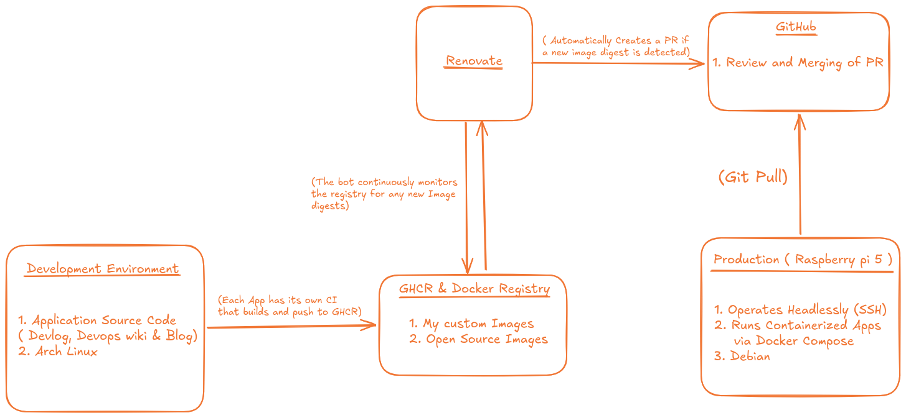

# Homelab
This repository contains the configuration and documentation for my personal homelab built on Cloud Native and DevOps principles. This is my safe space for testing my ideas practically without worrying about breaking real-world production environments.

## Architecture

Applications developed locally have their source code living in separate repos, each with its own CI that builds and pushes to GHCR. That makes this repository a deployment layer, it holds no application source, just the Compose files referencing images using their pinned digests. Renovate Bot watches over the registry and opens a PR the moment a new image digest is detected.

## Hardware
| Node | Role | Spec |
|---|---|---|
| Raspberry Pi 5 | Production(Operates headlessly hosting all the services) | 8GB RAM, 256GB PCIe NVMe SSD, Debian |
| Lenovo IdeaPad 3 | Development(Used for writing code and building container images) | 8GB RAM, 900GB HDD, Arch Linux |

## CI/CD Workflow

Deployments follow a GitOps-based pipeline using Renovate Bot and a webhook:

1.  Custom applications are developed on the Arch Linux machine, containerized, and pushed to a remote registry.
2.  Renovate Bot monitors the registry and automatically creates a Pull Request in this repository when a new image tag is detected.
3.  Merging the PR triggers a GitHub webhook, which is securely routed to my homelab via a Cloudflare Tunnel.
4.  An internal webhook receiver `adnanh/webhook` intercepts the payload and cryptographically verifies the signature and triggers a local script that restarts the affected containers with the new image tags.
## Services Stack

All services are containerized and orchestrated via Docker Compose:

| Service | Purpose | Network |
|---|---|---|
| DevLog | Personal activity tracker | `devlog_internal` + `homelab_net` |
| Paperless-ngx | Document management system | `paperless-internal` + `homelab_net` |
| Vaultwarden | Self-hosted password manager | `homelab_net` |
| Linkding | Bookmark manager | `homelab_net` |
| Homepage | Infrastructure dashboard | `homelab_net` |
| Wallabag | Read-it-later archive | `homelab_net` |
| Crumbs | Short notes taker | `homelab_net` |
| Pairdrop | LAN file transfer | `homelab_net` |
| Blog | Hugo-based personal site | `homelab_net` |
| DevOps Notes | Personal knowledge base | `homelab_net` |
| Cloudflare Tunnel | Ingress | `homelab_net` |
| Webhook Receiver | Intercepts incoming webhooks | `homelab_net` |

## Networking & Security

All self-hosted applications are accessible externally without exposing local ports to the internet.

*   **Ingress:** Cloudflare Tunnels route traffic securely to the Raspberry Pi.
*   **Local Security:** The production node is hardened with UFW and strict SSH configurations.
*   **Data Integrity:** Automated bash scripts handle snapshotting, compressing, and storing database backups locally.
