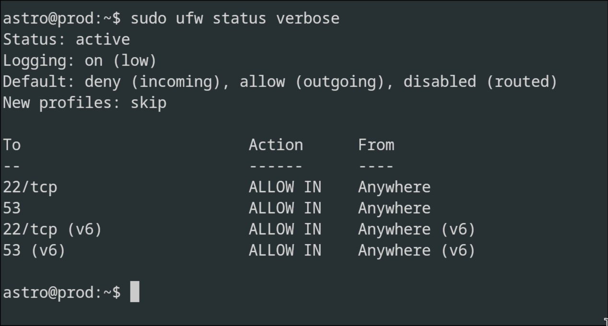

# UFW firewall configuration for the prod node (Raspberry PI)

- This is the default firewall configuration for Ubuntu developed to ease iptables firewall configuration
- It provides a user friendly way to set up firewall using the CLI
- This is a host-based firewall, the host in our case is the prod node (Raspberry Pi)
- The firewall is currently up and running, by running command `sudo ufw status verbose`, I can check the status of the firewall

- Default:deny(incoming) ---> This means that any traffic that doesn't match a rule will be blocked
- Default:allow(outgoing) ---> Any outgoing traffic from the prod is allowed

| Rule (To) | Action | From | Explanation |
| :--- | :--- | :--- | :--- |
| **22/tcp** | ALLOW IN | Anywhere | Any device can attempt to connect to SSH on port 22. |
| **53** | ALLOW IN | Anywhere | Allows incoming DNS traffic. |
| **22/tcp (v6)** | ALLOW IN | Anywhere (v6) | Same as SSH port 22, but for IPv6 addresses. |
| **53 (v6)** | ALLOW IN | Anywhere (v6) | Same as DNS port 53, but for IPv6 addresses. |

- I could explicitly set to only allow ssh traffic from Laptop A (admin) using IP filtering by using the command `ufw allow from <IP> to any port 22`, this is a strong security feature but I could lock myself out of prod because of DHCP IP change from the admin device.
